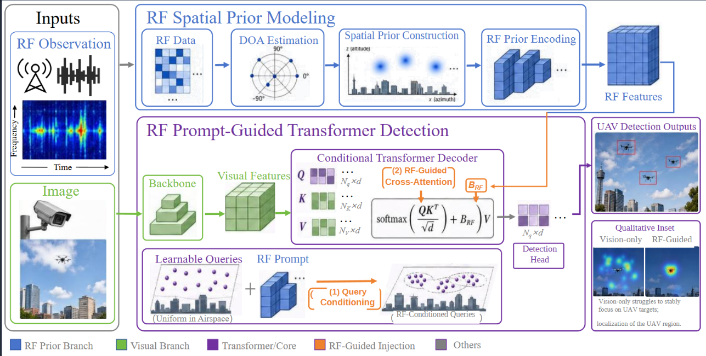
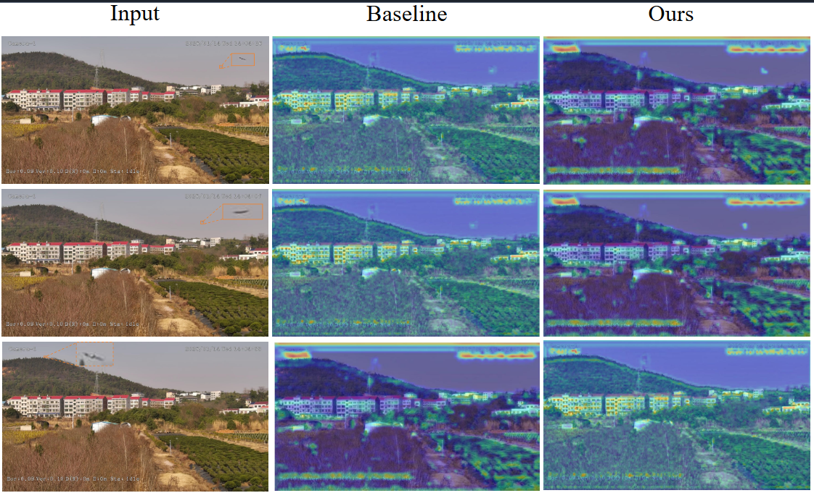

# RF-Prompt: RF-Guided UAV Detection

## 📌 Overview

We propose **RF-Prompt**, a Transformer-based UAV detection framework
that leverages RF signals as spatial priors.

-   RF signals are converted into structured prompts.
-   RF prompts are injected into Transformer queries.
-   RF-guided attention improves target localization.

## 🧠 Motivation

Small UAVs are difficult to detect in images, especially when they
occupy only a few pixels or appear against complex backgrounds.

RF signals provide complementary spatial information that can guide
visual detection and help the model focus on likely target regions.

------------------------------------------------------------------------

## 🏗️ Method

The proposed framework consists of two main components:

1.  **RF Spatial Prior Modeling (SPM):** transforms RF observations into
    an image-aligned spatial prior.
2.  **RF Prompt-Guided Transformer (PGT):** injects RF-derived prompts
    into Transformer query initialization and cross-attention to guide
    visual target search and feature aggregation.



------------------------------------------------------------------------

## 📊 Dataset

-   Approximately **2,500 images**
-   **150 RF I/Q segments**
-   Outdoor suburban scenes
-   Dataset split: **7:2:1** (training, validation, and testing)

------------------------------------------------------------------------

## 📈 Results

  Method                     AP (%)   AP50 (%)   AP75 (%)
  ---------------------- ---------- ---------- ----------
  YOLOv11                      64.5       78.5       57.9
  DETR                         62.6       76.4       55.3
  **Ours (RF-Prompt)**     **67.8**   **82.3**   **61.8**

RF-Prompt improves AP by approximately **6%** over the compared
baselines.

------------------------------------------------------------------------

## 🔎 Visualization

### Qualitative detection results


### Feature attention



------------------------------------------------------------------------

## 🚀 Usage

Install the dependencies:

``` bash
pip install -r requirements.txt
```

Run training:

``` bash
python train.py
```
